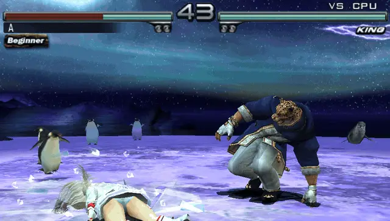
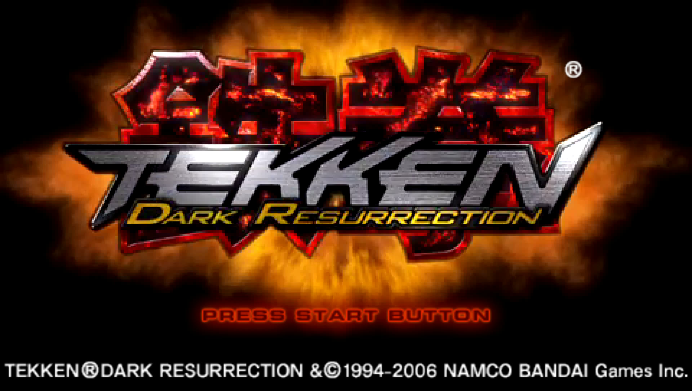
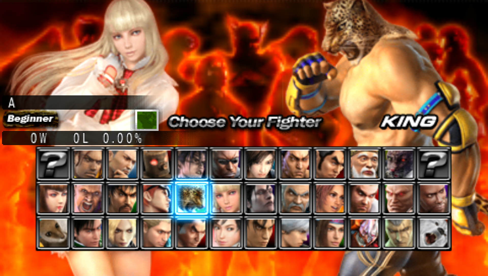
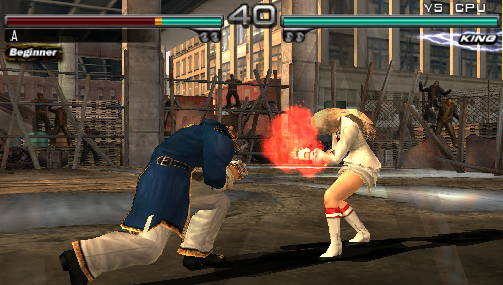
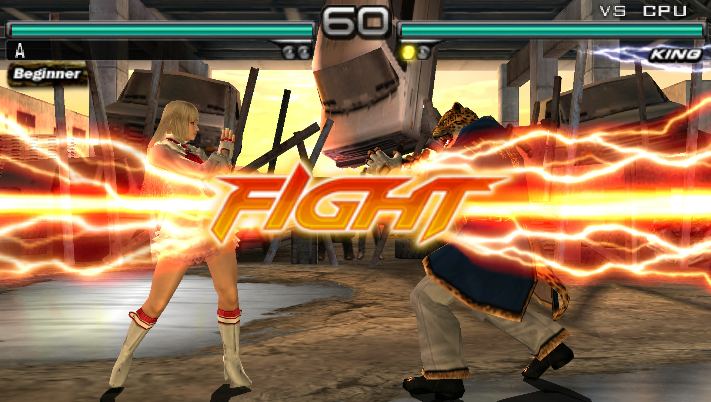
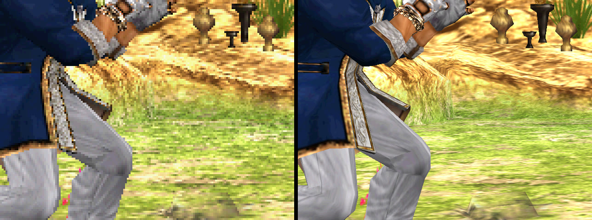
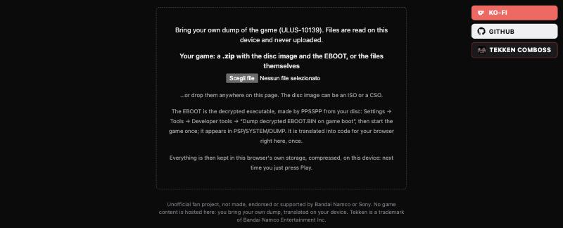
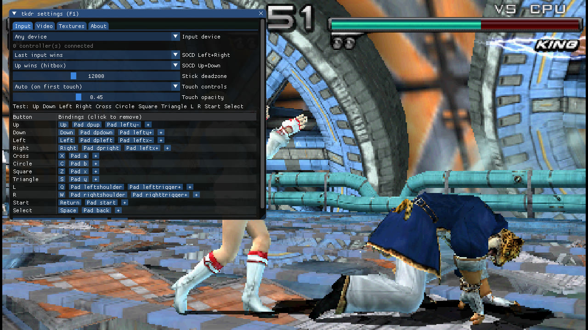
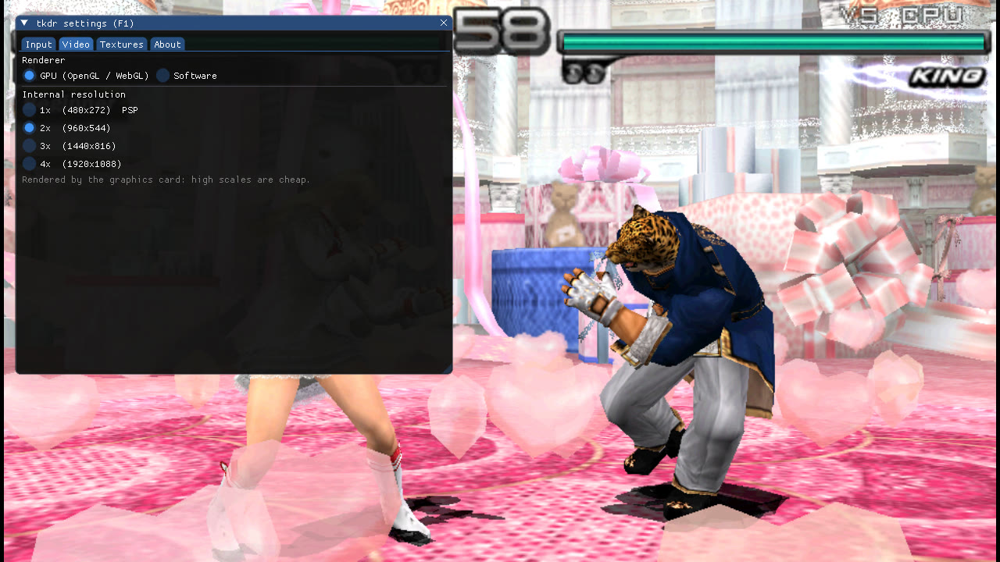
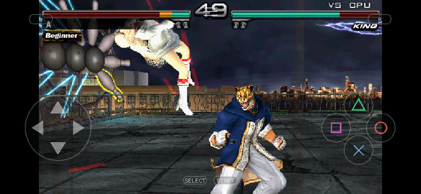

# tkdr-recomp

*Tekken: Dark Resurrection* (PSP) recompiled to run natively and in the browser,
at 60 fps and up to 4× resolution, with whatever controller you have.



The game's MIPS executable is translated ahead of time (to C for native builds,
or straight to WebAssembly **inside your browser**) and runs on a runtime that
reimplements the PSP's system libraries. No CPU emulation.

- **60 fps, up to 4×** internal resolution (1920×1088), drawn by the GPU (OpenGL / WebGL 2)
- **Play in the browser**, nothing to install: drop your own dump on the page and play
- **Any input**: keyboard, gamepads, arcade sticks, hitboxes (with SOCD modes),
  per-device bindings, on-screen touch controls on phones and tablets
- **HD texture packs**: PPSSPP packs work as they are; dump and replace your own
- Full screen, save data, movies with sound

| | |
|---|---|
|  |  |
|  |  |

<sub>Native build, 4× (1920×1088).</sub>



<sub>Same frame at the PSP's 480×272 (left) and at 4× (right).</sub>

## Bring your own game

**This repository contains no game data, and never will**: no executable, no
assets, no translated code, no keys. You need your own UMD of *Tekken: Dark
Resurrection* **ULUS-10139 (USA) v1.00**, dumped to an ISO or CSO, and its
decrypted EBOOT. [PPSSPP](https://www.ppsspp.org) makes it from your disc:
*Settings → Tools → Developer tools → Dump decrypted EBOOT.BIN on game boot*, boot
the game once, and it appears in `PSP/SYSTEM/DUMP/ULUS10139_EBOOT.BIN`.

Everything derived from the game is generated locally from your dump, into the
git-ignored `game/` and `build/`. Don't share those or any build made from them.

Unofficial fan project, not affiliated with or endorsed by Bandai Namco or Sony.
*Tekken* is a trademark of Bandai Namco Entertainment Inc.

## Play in the browser



Open the page, pick or drop a `.zip` with your disc image and EBOOT (or the files
themselves). The EBOOT is translated into WebAssembly in your browser in about a
second; the disc is stored compressed in the browser (1669 → 1109 MB). Nothing is
uploaded. Next time, just press *Play*.

Needs a recent desktop browser (Chrome, Edge, Firefox, Safari) with WebGL 2.

## Controls and settings

| Keyboard | PSP |
|---|---|
| Arrows | D-pad |
| Enter / Space | Start / Select |
| Z / X / C / S | □ / ✕ / ○ / △ |
| Q / W | L / R |

Gamepads, arcade sticks and hitboxes are picked up automatically; **F1** opens the
settings to rebind each device, choose the SOCD mode, the internal resolution,
the renderer and texture packs. **F** or double click for full screen.

| | |
|---|---|
|  |  |

On phones and tablets the page goes full screen with touch controls (d-pad, face
buttons, L/R, Start/Select, ≡ for settings), in landscape or portrait.



## Build

macOS or Linux with `python3`, `cmake`, `ninja`, a C/C++ compiler and SDL2;
Emscripten for the browser (`brew install cmake ninja sdl2 emscripten`).

```sh
tools/build.sh --iso path/to/game.iso --eboot path/to/ULUS10139_EBOOT.BIN --native --web
build/native/tkdr build/gen/image.bin path/to/game.iso
```

The script checks the ISO against its [redump](http://redump.org) hash and the
EBOOT against the supported version, translates it to C, builds a minimal FFmpeg
(H.264 only) and compiles. For the browser build, `python3 tools/serve.py build/web 8080`
and open `http://localhost:8080/tkdr.html`.

### Hosting

```sh
tools/build.sh --web-host
```

needs no game files and produces `build/web-host/`, the page with the in-browser
recompiler: **nothing from the game is in it**, so this folder is what can be put
online (any static host sending the COOP/COEP headers in `_headers`).
`tools/make_deploy.sh [--push]` puts it on a `deploy` branch with a `render.yaml`
for Render. Never host `build/web/` or `build/native/`: those contain the
translated game.

`config.json` next to the page can make it load the zip from your own server
instead of asking for files (`{"pickFiles": false, "gameZip": "http://my-nas.local/tekken.zip"}`,
or `PICK_FILES` / `GAME_ZIP` with `tools/web_config.py`). **Only on a private
network or behind a login, with your own copy**: a page anyone can open that hands
out the game is distributing it. Public builds always ship with `pickFiles: true`.

## Texture packs

Put a PPSSPP pack (`textures.ini` and the PNGs) in `textures/ULUS10139/`, or point
`TEX_DIR` at it. To make your own, enable *Dump new textures* in F1 → Textures:
every texture is saved to `textures/ULUS10139/new/` with PPSSPP's names; edit,
move it up a folder and press *Reload pack*.

## Status

Boots, movies with sound, menus, save/load and full matches at 60 fps up to 4×,
natively and in the browser. Tested from boot to Quick Battle; other modes are
less explored. Missing: SAS reverb, ad-hoc multiplayer.

## How it works

- `recomp/`: loads the PRX, decodes Allegrex, finds functions and emits one C
  function per guest function.
- `runtime/`: guest memory, a PSP-like scheduler on host threads, HLE of the
  system libraries, VFPU, the GE (vertex pipeline on the CPU, then the GPU
  renderer or a multi-threaded software rasterizer), SAS/ATRAC3+/H.264, input,
  touch and settings UI, an SDL2 frontend that also builds with Emscripten.
- `web/recomp/`: the same recompiler in JavaScript, writing WebAssembly directly.
- `web/disc.mjs`: zip, ISO and CSO in the browser.
- `tools/`: build, ISO/CSO, local server and deploy helpers. Debugging aids are in `NOTES.md`.

## Contributing

Welcome. Read [CONTRIBUTING.md](CONTRIBUTING.md) first: the one hard rule is that
nothing derived from a game ever enters the repository.

## Licenses

The project's code is MIT ([LICENSE](LICENSE)). Third-party code keeps its own:
`third_party/at3_standalone/` (ATRAC3/3+ from FFmpeg via PPSSPP, LGPL-2.1+),
`third_party/imgui/` (MIT), `third_party/stb/` (public domain), and FFmpeg's H.264
decoder, downloaded and built by `tools/build_ffmpeg.sh` (LGPL-2.1+). The LGPL
sources are in the repository or fetched by the build, as the LGPL requires.
PPSSPP's source served as documentation; `recomp/nids.json` lists the public
names of the PSP functions the game imports.

## Support

[Ko-fi](https://ko-fi.com/gacid) · [GitHub](https://github.com/gasparegas) · [Tekken Comboss](https://tekken-comboss.com/)
